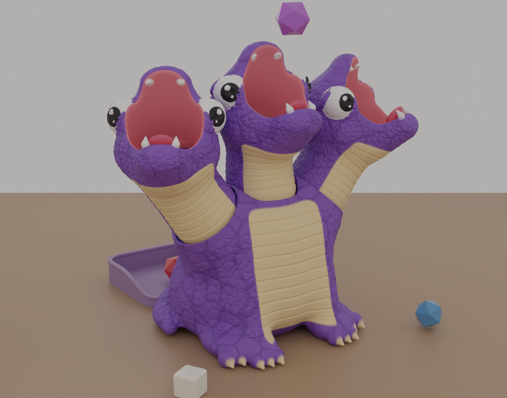
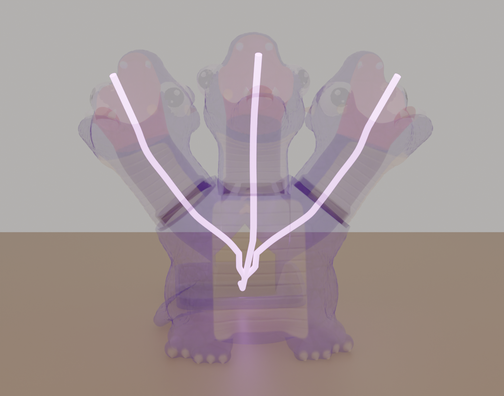
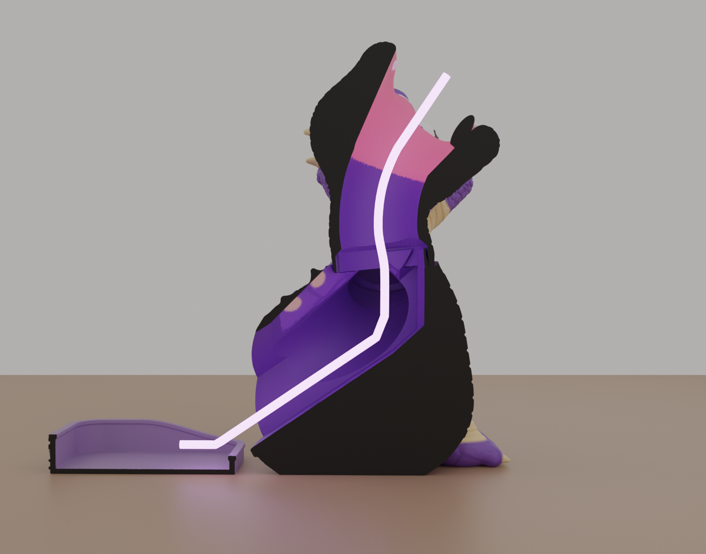
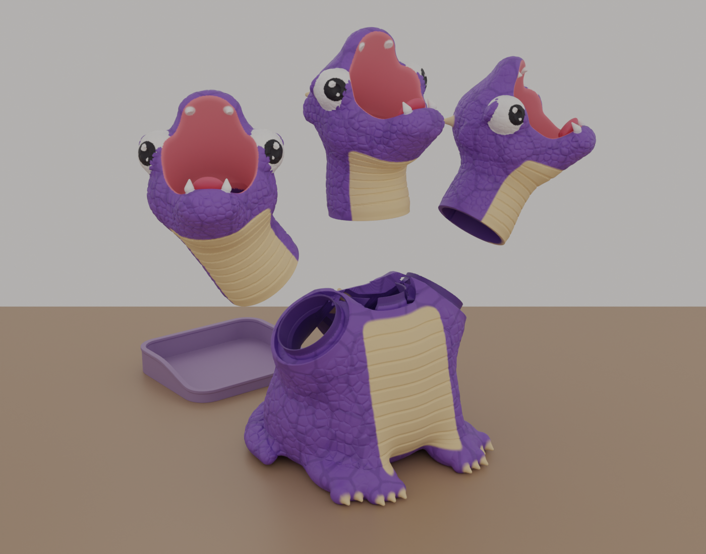
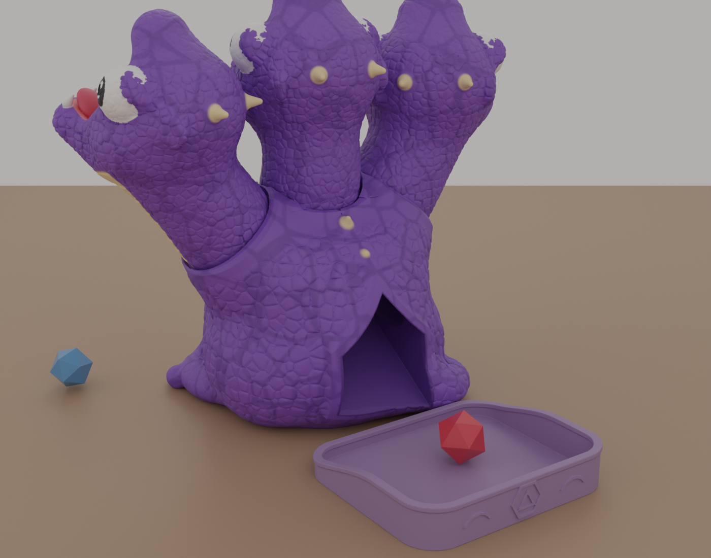

# Baby Hydra Dice Tower — 3D-printable model

A three-headed baby hydra dice tower. Drop a die into **any** of the three
mouths; it falls down that neck, through a Y-junction inside the body, rolls
down a ramp and plops out of an arch in the hydra's rear into a removable tray.



| | |
|---|---|
|  |  |
| Glowing lines: the three dice paths | True section at x = 0 (centre path, ramp, exit) |
|  |  |
| Exploded assembly (keyed spigots) | Rear exit + tray |

## What's in this folder

| Path | What it is |
|---|---|
| `stl/*.stl` | **The print files.** 5 parts, already in print orientation. |
| `stl/assembly.json` | 4×4 placement of each part in the assembled model. |
| `docs/PRINTING_AND_ASSEMBLY.md` | **Slicer settings for the AD5X, orientation, supports, assembly steps.** |
| `docs/validation_report.json` | Automated checks (manifold, build volume, overlaps, overhangs, ball passage). |
| `docs/dice_simulation.json` | Physics drop test results (pybullet). |
| `renders/` | Assembled, exploded, cutaway, section and print-layout images. |
| `blender/hydra_dice_tower.blend` | Editable Blender scene (collections: Assembled, Exploded, Cutaway, Section, PrintPlates). |
| `blender/build_scene.py` | Blender (bpy) script that builds that scene and the renders. |
| `generator/hydra_model.py` | **All of the shape design**: every dimension and every body part as a signed distance function. |
| `generator/build_parts.py` | Turns the shapes into STL files (grid → overhang closure → marching cubes → decimation → manifold check). |
| `generator/validate.py` | The checks listed below. |
| `generator/simulate_dice.py` | Physics drop test. |
| `generator/colorize.py` | Vertex colours for the renders (purple/cream/eyes) + dice-path lines. |

## The dice path, and why it is shaped this way

1. **Mouths**: a cone widening from 37 mm at the throat to 55 mm at the lips,
   tilted ~35° from vertical. A die dropped from above falls straight in. The
   floor of the mouth slopes about 45° into the throat, so dice can't sit on the tongue.
2. **Necks**: a 37 mm round tube with a gentle S-bend (the first tumble).
3. **Joint**: each neck slides over a keyed spigot on the body. The tube gets
   *slightly wider* at every step going down (37.0 → 37.8 mm), so no edge can
   catch a die.
4. **Y-junction in the body**: the centre tube drops vertically about 40 mm onto a 42°
   deflector (a hard impact, the second tumble). The side tubes descend at
   about 40° and join the ramp from the sides.
5. **Ramp + exit**: a 34° ramp in a 46 mm-wide arched tunnel (45° gothic roof)
   leads out through the rear arch. The exit lip sits about 14 mm above the table,
   so dice drop into the tray (the third tumble).

**Printability by construction:** `build_parts.py` runs an *overhang closure*
pass on every part in its print orientation. Working up the voxel grid layer
by layer, it removes any material above an internal cavity that isn't
supported within 45°. Every internal ceiling therefore ends up as an arch or a
45° slope, and no support is ever needed inside the dice path.

## Verification results (final geometry)

| Check | Result |
|---|---|
| Exactly three heads, each mouth connected to the exit | Yes. The body has exactly 4 openings (3 inlets + exit), each neck exactly 2 (mouth + joint) |
| Watertight, manifold STLs | All 5 parts pass (`manifold3d`: NoError, trimesh watertight) |
| Fits AD5X 220×220×220 | Largest part: body 134 × 134 × 110 mm |
| Parts overlap when assembled | 0.0 mm³ for every pair |
| Largest sphere that rolls (only downhill) from every mouth to the exit | **35.9 mm** (36 mm through both side mouths) |
| Places a 34 mm sphere could come to rest inside the tower | **None** (the only resting spots are outside, on the lips or chin) |
| Internal surfaces steeper than 50° in print orientation | 0.1–0.2 % of internal area (≈ 12–42 mm², voxel noise) |
| Physics: d4–d20 (26 mm), 20 drops × 3 mouths each | 359/360 in the tray, 0 stuck inside |

**Physics drop test (pybullet, `docs/dice_simulation.json`):** 359 of 360 drops
(d4, d6, d8, d10, d12 and a 26 mm d20; 20 random drops into each of the 3
mouths) landed in the tray, with **no die stuck inside the tower**. The one
miss was a d6 from the left mouth that came out of the exit but ended up on
the table just behind the rump (a bounce-out, or a contact glitch in the simulation).

**Fairness:** 300 d6 drops, all starting in the *same* orientation, gave face counts
42 / 50 / 50 / 55 / 55 / 48 (χ² = 2.36, below the 11.07 cutoff at 95%). The
tower doesn't carry the starting face through to the result.

## Size

Assembled: about **225 mm wide × 134 mm deep × 207 mm tall** (plus the
tray, which adds about 90 mm of depth behind). This is **wider and taller than the 150–190 ×
170–200 mm you suggested**. The 37 mm dice tubes set the neck thickness
(about 48 mm). The heads then had to be spread far enough apart that they
don't collide, and the internal Y-junction needs about 110 mm of body height. Each
part fits the AD5X on its own. To make it smaller you'd have to shrink the
dice channel, which conflicts with the 34–36 mm clearance target.

## Honest limitations

- **It looks like the reference, but it's not identical.** The proportions
  follow the dice path. The necks are chunkier than in the concept art,
  the heads look upward, and the scales are a procedural pattern (raised
  cells about 0.6 mm high), not hand-sculpted overlapping scales. A digital sculptor
  could add more character on top of these STLs without touching the internals.
- **Single-colour geometry.** The purple/cream look comes from slicer
  colour-painting on the AD5X, or from paint. See the printing guide.
- **Physics tests are a simulation.** Bullet with PLA-like friction (0.35) and
  acrylic dice is a good test for dead spots and jams. It's not a guarantee
  for every real-world die, especially heavy metal dice or dice
  larger than 26 mm.
- **Not test-printed.** The first real print is the real validation. The
  spigot fit (0.25 mm clearance) is the setting most likely to need tuning
  for your printer and filament. Print one neck first and check the fit.

## Regenerating the model

Requires Python 3.10+:

```bash
pip install numpy scipy scikit-image trimesh manifold3d fast-simplification
cd generator
python build_parts.py            # ~8 min at 0.35 mm; --res 1.0 for a 30 s preview
python validate.py               # ~15 min
python colorize.py
cd ../blender && blender --background --python build_scene.py -- --render
# optional physics test (needs pybullet):  python simulate_dice.py --drops 20 --fair 300
```

Every dimension lives at the top of `generator/hydra_model.py` (channel
sizes, fit clearance, ramp angles, wall thickness).

### Why not pure Blender Python?

You asked for a bpy script that builds the model. I went another route for the
*geometry* and used Blender for assembly, inspection and rendering. Blender's
boolean modifiers on organic, high-poly shapes often leave non-manifold edges,
which is exactly what a slicer chokes on. They also can't enforce "every
internal ceiling ≤ 45°". The signed-distance approach makes every
union and subtraction plain arithmetic, and marching cubes always produces
closed, watertight meshes. The pieces still come together in Blender:
`blender/build_scene.py` assembles the parts, colours them, renders every view and
saves the `.blend`. You can open, edit and re-export from there.
